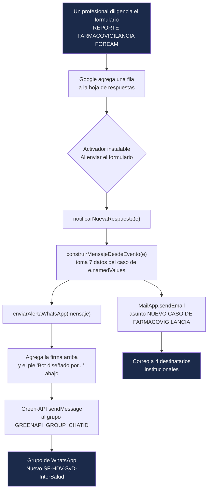

# Alertas WhatsApp - Farmacovigilancia HDV

Bot de Google Apps Script que avisa por **WhatsApp** (vía [Green-API](https://green-api.com/en/)) y por **correo** cada vez que se reporta un evento adverso a medicamentos en el formulario **REPORTE FARMACOVIGILANCIA FOREAM** del Hospital Departamental de Villavicencio E.S.E. (HDV).

| Recurso | Enlace |
|---|---|
| Formulario | [REPORTE FARMACOVIGILANCIA FOREAM](https://docs.google.com/forms/d/1KOlHQzOW34i6Ph90Nkvy6T408tNaIOtWHI6YepBCNSw/edit) |
| Hoja de respuestas | [REPORTE FARMACOVIGILANCIA FOREAM (Respuestas)](https://docs.google.com/spreadsheets/d/1WtanrKDi_T7D1MvgwSKV2VpY88OLd_QVuWGGckzZXFc/edit) |
| Proyecto Apps Script | [Bot Farmacovigilancia](https://script.google.com/u/1/home/projects/1JPWTy92P23cn6pmGc3DHxbuWGK_envNBJexoqBS4PuenfDdHBALKASP4/edit) (vinculado a la hoja; archivo "Código") |
| Código en este repo | `Codigo.gs` |

## Cómo funciona



Paso a paso:

1. **Llega un reporte.** Al enviarse el formulario, Google agrega una fila a la hoja y dispara el activador instalable "Al enviar el formulario", que llama a `notificarNuevaRespuesta(e)`. No hay ningún proceso por reloj.
2. **Se arma el mensaje.** `construirMensajeDesdeEvento(e)` toma de `e.namedValues` las 7 respuestas de la tabla de abajo. `campo(nombre)` busca el título **exacto** de la pregunta; si no lo encuentra o viene vacío, muestra `-`.
3. **WhatsApp.** `enviarAlertaWhatsApp()` lee las credenciales de Propiedades del script, pone la firma en negrita arriba (`Bot Farmacovigilancia HDV` o lo que diga `GREENAPI_BOT_LABEL`) y el pie en cursiva abajo, y hace un `POST` a `sendMessage` de Green-API hacia el grupo.
4. **Correo.** Después envía el mismo texto, sin firma ni pie, con `MailApp.sendEmail` a los destinatarios fijos del código (dirección técnica y químicos farmacéuticos).

> Si la llamada a Green-API lanza una excepción (por ejemplo, sin conexión), la ejecución se detiene y el correo de ese caso no sale. Los errores HTTP (como 466) no la detienen: quedan en el registro y el correo sí sale.

### Datos del mensaje

| En el mensaje | Pregunta del formulario (título exacto) |
|---|---|
| 👤 Nombre del Reportante | `Nombre del reportante` |
| 🎓 Profesión del Reportante | `Profesión del reportante` |
| 🎂 Edad del Paciente | `Edad del paciente en el momento del Evento Adverso Años/Meses/Días` |
| 📋 Diagnóstico del Paciente | `Diagnóstico del paciente` |
| 💊 Medicamento Sospechoso (vía / frecuencia) | `Medicamentos sospechosos junto a la vía de administración (IV, SC, IM, etc.) y frecuencia de administración de los medicamentos formulados (6, 8, 12 H, dosis única o cada cuántos días).` |
| 🏥 Servicio donde Ocurrió el Evento | `Servicio donde ocurrió el evento adverso` |
| 📝 Descripción del Evento | `Descripción análisis del evento adverso` |

Estos títulos se verificaron contra el formulario el 2026-08-02 (ver `CHANGELOG.md`). Si alguien edita el texto de una pregunta, ese dato empezará a salir como `-` sin ningún error: hay que actualizar el nombre en `campo("...")`.

### Ejemplo (datos ficticios)

```
*Bot Farmacovigilancia HDV*

🚨 NUEVO CASO DE FARMACOVIGILANCIA 🚨

👤 Nombre del Reportante: Juan Pérez
🎓 Profesion del Reportante: Enfermero jefe
🎂 Edad del Paciente: 45 años
📋 Diagnostico del Paciente: Hipertensión arterial
💊 Medicamento Sospechoso (via / frecuencia): Losartán - oral - cada 12 horas
🏥 Servicio donde Ocurrio el Evento: Urgencias
📝 Descripcion del Evento: Hipotensión sintomática 30 minutos después de la administración

_Bot diseñado por el QF Juan Pablo Saavedra · Servicio Farmacéutico HDV_
```

## Configuración (Propiedades del script)

En el editor de Apps Script: **Configuración del proyecto → Propiedades del script**. Ninguna credencial va en el código: este repositorio es público.

| Propiedad | Obligatoria | Descripción |
|---|---|---|
| `GREENAPI_ID_INSTANCE` | sí | ID de la instancia de Green-API (compartida con los otros bots) |
| `GREENAPI_API_TOKEN` | sí | Token de la instancia (secreto) |
| `GREENAPI_API_URL` | sí | URL base de la API, ej. `https://7107.api.greenapi.com` |
| `GREENAPI_GROUP_CHATID` | sí | chatId del grupo de destino; siempre termina en `@g.us` |
| `GREENAPI_BOT_LABEL` | no | Firma en negrita al inicio del mensaje (por defecto `Bot Farmacovigilancia HDV`) |

Si falta alguna de las cuatro obligatorias, no se envía el WhatsApp (queda en el registro) y el correo sí sale.

### Grupos

| Grupo | chatId | Uso |
|---|---|---|
| Nuevo SF-HDV-SyD-InterSalud | `120363426937928040@g.us` | **Producción** |
| PRUEBA BOT | `120363412506101174@g.us` | Pruebas |

Para encontrar el chatId de un grupo sin riesgo de enviar nada, ejecutar `listarChatsGreenAPI()`: solo lee (`getChats`) y registra los grupos (`@g.us`) con su nombre.

## Activador

Ya está creado en el proyecto: **Activadores → `notificarNuevaRespuesta` · Desde la hoja de cálculo · Al enviar el formulario**. Debe existir uno solo; si hubiera dos, cada reporte llegaría duplicado.

## Funciones

| Función | ¿Envía algo? | Uso |
|---|---|---|
| `notificarNuevaRespuesta(e)` | Sí (WhatsApp + correo) | La llama el activador. No ejecutarla a mano: sin `e` envía al grupo y por correo un caso con todos los datos en `-` |
| `construirMensajeDesdeEvento(e)` | **No** | Arma el texto del mensaje |
| `enviarAlertaWhatsApp(mensaje)` | Sí | Envío a Green-API con firma y pie |
| `listarChatsGreenAPI()` | **No** | Lista los grupos visibles para la instancia |
| `eventoDePrueba()`, `eventoCaso1()`, `eventoCaso5()`, `eventoCaso7()` | **No** | Datos de prueba (ficticios y de 3 casos históricos) |
| `testConstruccionMensaje()` | **No** | Escribe en el registro el mensaje del caso ficticio |
| `enviarEjemploAlGrupo()` | Sí | Envía el caso ficticio al grupo configurado |
| `enviarCasosReales()` | Sí (3 mensajes) | Reenvía los 3 casos históricos; ya se usó para validar el formato, no repetir |

Antes de ejecutar cualquier función que envía, confirmar que `GREENAPI_GROUP_CHATID` apunta a PRUEBA BOT.

## Cómo se actualiza el bot

El editor de Apps Script **no** se sincroniza con GitHub. Para cambiar el bot:

1. Hacer el cambio en `Codigo.gs` en este repo y correr las pruebas locales.
2. Copiar el cambio al editor (archivo "Código" del proyecto Bot Farmacovigilancia) y guardar con Ctrl+S. No hace falta publicar: el activador usa siempre la última versión guardada.
3. Probar con `GREENAPI_GROUP_CHATID` en PRUEBA BOT antes de volver a producción.

Al pegar texto con tildes o emojis, el editor a veces los daña. Los textos nuevos se escriben con escapes `\u` (como el pie) o con `String.fromCodePoint()`.

## Pruebas locales (sin red ni credenciales)

```bash
node test/dry-run.js     # formato del mensaje (reconstruye construirMensajeDesdeEvento en Node)
node test/pie-firma.js   # carga el Codigo.gs real y verifica que el mensaje termine con el pie
```

## Green-API compartida: cuidado con el cupo de chats

La instancia de Green-API es la misma para los 4 bots del Servicio Farmacéutico y está en el plan Developer (gratis). Ese plan **no limita mensajes, sino chats distintos por mes: 3**, contando los que escriben al número del bot; el contador se reinicia el día 1. Hoy se usan 2 (grupo de producción y PRUEBA BOT). Si se escribe a un cuarto chat, o alguien le escribe por privado al número del bot, Green-API responde 466 y **los 4 bots** dejan de enviar hasta el día 1.

| Bot | Qué lo dispara | Repositorio |
|---|---|---|
| Farmacovigilancia | Formulario FOREAM | este repositorio |
| Tecnovigilancia | Formulario FOREIA001 | [alertas-whatsapp-tecnovigilancia](https://github.com/jsaavedran1-glitch/alertas-whatsapp-tecnovigilancia) |
| PROA antimicrobianos | Formulario de antimicrobianos restringidos | [alertas-whatsapp-antimicrobianos](https://github.com/jsaavedran1-glitch/alertas-whatsapp-antimicrobianos) |
| Alertas INVIMA | Reloj (4 revisiones diarias) | [alertas-whatsapp-sanitarias-invima](https://github.com/jsaavedran1-glitch/alertas-whatsapp-sanitarias-invima) |

## Reglas

- **Solo a grupos.** El destino siempre termina en `@g.us`; nunca se envía a una persona (`@c.us`).
- **Ninguna credencial en el código.** Todo vive en Propiedades del script.
- **Pruebas solo en PRUEBA BOT**, nunca en el grupo de producción.

## Marco regulatorio de referencia

Resolución 4816 de 2008, algoritmo OMS-UMC de causalidad, Resolución 3100 de 2019.

## Ver también

`CLAUDE.md` (contexto operativo para asistentes de IA) y `CHANGELOG.md` (historial de cambios).
